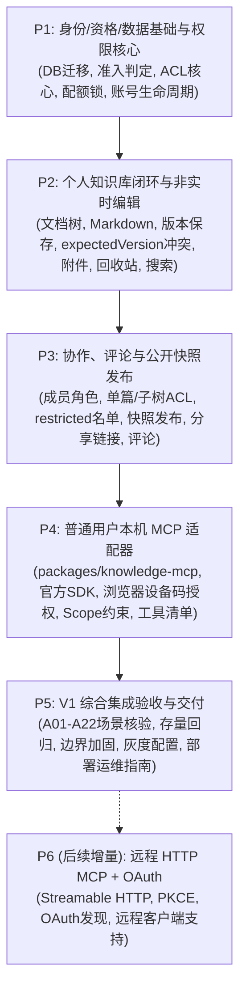

# 博客个人知识库 V1 实施计划（P0 规划）

日期：2026-11-05
状态：规划草案已就绪，等待正式实施授权
对应设计：[2026-11-05-personal-knowledge-base-design.md](file:///F:/@ts/myblog/docs/superpowers/specs/2026-11-05-personal-knowledge-base-design.md)
配套提示词手册：[personal-knowledge-base-ai-prompts.md](file:///F:/@ts/myblog/docs/prompts/personal-knowledge-base-ai-prompts.md)

---

## 1. 现状核实、源码差异与可复用能力分析

本实施计划经对本地工作区 `F:\@ts\myblog`（当前 HEAD 提交 `f31e49d`，工作区树干净）实际源码分析制定。**文档中的描述不直接作为已实现事实，所有依赖必须基于实际代码现状。**

### 1.1 工作区与外部参考现状
* **工作区基础**：pnpm workspace（monorepo）单体架构，包含根目录、`apps/web`（React 19 + Vite）、`apps/api`（Express 5 + TypeScript + mysql2）、`packages/blog-mcp`（Node.js 原生 stdio）。
* **Firefly 参考项目**：经本地路径核查，`F:\@ts\myblog\Firefly-master` 与 `F:\@ts\Firefly-master` 均不存在。后续前端页面（尤其是公开阅读与展示页）以当前前端主题组件及线上参考站 [https://firefly.cuteleaf.cn/](https://firefly.cuteleaf.cn/) 的圆角卡片、毛玻璃、明暗主题和响应式布局为视觉基准。

### 1.2 源码现状核对与差异矩阵

| 模块 / 维度 | 当前源码实际状态（根据代码核实） | 个人知识库设计要求 | 实施差异与处理方案 |
| :--- | :--- | :--- | :--- |
| **用户体系** | `comment_users`（普通用户，自增 ID）与 `admin_users`（后台管理员，自增 ID）物理分离（`schema.sql:190, 739`）。 | 知识库所有者与协作者仅绑定 `comment_users`。普通用户与管理员在权限、数字 ID 上严格隔离。 | 业务逻辑、ACL 和外键均指向 `comment_users.id`；禁止将管理员上下文与普通用户混用；杜绝数字 ID 碰撞引发的权限越权。 |
| **活跃与登录** | `comment_users` 仅有 `created_at`、`updated_at`、`last_login_at`（`schema.sql:202-204`）；无每日明细和积分模型。 | 严格要求注册超过 30×24 小时，且近 30 个 UTC 日按 $D, U, S, W$ 积分计算活跃度。 | 需新增 `user_activity_events` 与 `user_activity_daily` 每日汇总表；上线初期采样不足如实告知用户，不伪造历史。 |
| **存储层** | `apps/api/src/storage.ts` 支持 Local、Cloudflare R2 和 Worker 三种驱动；具备私有 `user-space/` 读写。 | 知识库附件需按库所有者进行私有存储，并实施权限隔离。 | 复用底层存储驱动（S3 Client / Worker / Local），新增独立的知识库存储前缀 `kb-files/`，且所有附件下载走服务端鉴权接口。 |
| **配额管理** | `repository.ts:916` 中 `lockedUserUsage` 通过 `SELECT ... FOR UPDATE` 对用户空间（图床、剪贴板、表情）共用 30 MiB 进行行级加锁统计。 | 知识库独立 100 MiB 额度，费用由库所有者（Owner）承担，不挤占原 30 MiB 用户空间。 | 独立设计 `kb_quota` 逻辑，沿用悲观行锁，严格遵守统一加锁顺序：所有者账号行 $\to$ 知识库行 $\to$ 文档行。 |
| **Markdown 与编辑** | 前端 `MdEditorBridge.tsx` 封装了 `md-editor-v3`；`MarkdownContent.tsx` 基于 `marked` + `DOMPurify`。 | 知识库首版采用 Markdown 非实时编辑，支持版本保存与冲突提示。 | 抽取公共富文本桥接组件至 `apps/web/src/components/markdown/`，定制知识库图片上传与内部链接解析（`kb://` 协议解析）。 |
| **审计与脱敏** | `server.ts:226-273` 全局请求中间件拦截并记录管理员审计日志（`writeAuditLog`），记录 body/query。 | 严禁将文档正文、搜索词、Token、设备码、分享密钥写入日志。 | 在 `auditExcludedRequest` 中增加 `/api/knowledge/`、`/api/kb-agent/` 及所有涉及知识库的路由排除或敏感数据脱敏。 |
| **账号删除** | `repository.ts:1198` 与 `server.ts:2223` 执行 `DELETE FROM comment_users WHERE id = ?`，级联清空 sessions。 | 拥有知识库的用户禁止硬删除，必须返回 `409 USER_OWNS_KNOWLEDGE_DATA`；协作者注销不删已有版本。 | 修改 `deleteCommentUser` 逻辑，增加前置所有权检查；外键声明严格使用 `RESTRICT`，保留协作者历史审计。 |
| **智能体 MCP** | `packages/blog-mcp` 仅为管理员设计，使用手写 stdio 帧，绑定 `admin_grants`。 | 为普通用户提供独立的知识库 MCP，基于官方 `@modelcontextprotocol/sdk`，独立授权。 | 新增 `packages/knowledge-mcp` 子项目；旧 blog-mcp 保持现状不变，两套凭据与 token 隔离。 |

---

## 2. P1–P5 工作分解、依赖顺序与交付计划



### 2.1 P1：身份、资格、数据基础与权限核心
* **交付范围**：
  1. **数据库迁移脚本**：实现核心表结构的创建、字段索引与外键约束，保证空库和存量库幂等执行。
  2. **事件驱动的活跃度引擎**：
     * 业务成功事件采集中间件：在现有白名单操作（剪贴板变更、图床上传、代码执行、审核评论）成功返回时，异步且幂等地记入 `user_activity_events`。
     * 每日聚合任务与 100 分制算法实现（$D, U, S, W$ 计算），输出 `kb_entitlements`。
     * 提供 `GET /api/knowledge/eligibility` 查询接口，包含状态、进度及缺失条件。
  3. **ACL 权限核心层**：实现无状态权限判决器 `evaluateAccess(principal, resource, context)`，覆盖 `owner`、`manager`、`editor`、`commenter`、`viewer` 角色及祖先链 `restricted`、`members_only`。
  4. **并发与配额保护**：实现知识库专用的带锁事务上下文与统一锁顺序（账号行 $\to$ 库行 $\to$ 文档行）。
  5. **生命周期约束**：加固 `deleteCommentUser`，拦截拥有知识库的账号硬删除；协作者注销时保留正文历史，置空 `actor_user_id`。
  6. **安全脱敏**：在 `server.ts` 中拦截知识库所有路径的正文、搜索词与凭据入库。

### 2.2 P2：个人知识库与非实时编辑闭环
* **交付范围**：
  1. **库与目录树管理**：知识库的创建/编辑/软删除；文档树的层级结构（最大深度 20 层），支持文件夹（`kind: folder`）与文档（`kind: document`）。
  2. **Markdown 编辑与不可变版本**：
     * 前端集成定制的 `MdEditorBridge`，支持分栏、大纲提取、图片粘贴上传。
     * 服务端原子保存契约：请求必须携带 `expectedVersion`，若不匹配返回 `409 VERSION_CONFLICT`；保存内容无变更返回 `unchanged`，不生成冗余 revision。
     * 前端串行自动保存队列（输入停止 2 秒或最长 15 秒触发），冲突时保留本地草稿并提供差异对比。
  3. **历史版本与恢复**：浏览不可变 revision 列表；历史恢复创建新版本，不覆盖历史快照。
  4. **附件管理**：附件上传暂存、绑定到文档 revision；跨文档复制建立独立副本；24 小时未绑定暂存物理清理。
  5. **全文搜索**：基于 MySQL `ngram` 全文索引，结合 ACL 进行资源过滤，返回匹配高亮与摘要。
  6. **回收站与 Markdown 导出**：30 天软删除保留，子树级联软删除；单篇与批量 ZIP 格式导出。

### 2.3 P3：协作、评论与公开快照发布
* **交付范围**：
  1. **多用户协作共享**：
     * 库级成员管理与角色分配（manager, editor, commenter, viewer）。
     * 单篇/子树精确 ACL 授权（`kb_document_access`）；`restricted` 节点名单上限与祖先链穿透判定。
     * 节点移动权限校验：普通 editor 仅允许在等效继承受众内移动；跨越受限目录需具备 `share` 权限与严格达标状态。
  2. **草稿与公开快照彻底隔离**：
     * 发布操作生成/绑定 `published_revision_id`；公开发布主页仅展示已发布的快照。
     * 任何未发布的草稿标题、正文、附件在公开接口与公开搜索中 100% 屏蔽。
  3. **安全分享链接**：
     * 生成高熵随机 Token（数据库存 SHA-256 哈希），支持设定有效期与撤回。
     * 分享落地页通过内存交换一次性读取 Session 并清理 URL 参数，设置 `Referrer-Policy: no-referrer`。
  4. **多通道评论系统**：
     * 内部工作版本评论：仅具名协作者可见。
     * 公开快照评论：对注册用户开放，支持前置审核流程与解决标记（resolved）。

### 2.4 P4：普通用户本机 MCP 适配器
* **交付范围**：
  1. **新建子包 `packages/knowledge-mcp`**：基于官方 `@modelcontextprotocol/sdk`，实现标准 stdio JSON-RPC 通信。
  2. **普通用户浏览器授权流（Device Flow）**：
     * `kb_connect` 工具唤起浏览器本站授权页面（`/knowledge/authorize`）。
     * 用户完成登录，自主勾选需要授权的知识库、有效期（1~30 天）及敏感 scope（`kb:write`, `kb:publish`, `kb:share`, `kb:delete` 等）。
     * 授权凭据采用加密投递，换取 Grant Token（本地安全存储，服务端仅存哈希）。
  3. **工具集契约与实现**：
     * 浏览组：`kb_status`、`kb_list_libraries`、`kb_get_tree`、`kb_get_document`、`kb_search`。
     * 写入组：`kb_create_document`、`kb_update_document`、`kb_move_document`（全量携带 `expectedVersion` 与 `idempotencyKey`）。
     * 版本与评论：`kb_list_revisions`、`kb_restore_revision`、`kb_list_comments`、`kb_add_comment`。
     * 敏感组：`kb_preview_publication`、`kb_publish_document`、`kb_unpublish_document`、`kb_set_member`、`kb_create_share_link`、`kb_trash_document`。
  4. **连接管理与撤销**：用户中心前端页面 `/knowledge/connections` 支持查看已授权 MCP 连接并支持一键撤销。

### 2.5 P5：V1 综合集成验收与交付
* **交付范围**：
  1. **全场景端到端核验**：对照设计文档 A01~A22 场景逐一实测，输出测试通过凭据表。
  2. **兼容性与回归测试**：确保原有博客文章发布、管理后台、已有评论、用户空间 30 MiB 文件系统及旧版管理员 MCP 零回归。
  3. **功能开关与容灾配置**：通过环境变量与系统配置控制功能开关（默认关闭），验证一键关闭与只读维护模式。
  4. **运维与使用文档**：编写本地部署、数据迁移指南、客户端连接配置手册。

---

## 3. 实际文件落点规划

为保持代码整洁并杜绝将万行代码写入单一文件，严格按照领域职责进行模块化组织：

```text
F:\@ts\myblog\
├── apps/
│   ├── api/
│   │   └── src/
│   │       ├── knowledge/                       # 【新增】知识库核心业务模块
│   │       │   ├── types.ts                     # 领域模型定义与 Zod 校验规则
│   │       │   ├── constants.ts                 # 活跃度算法、配额、保留期等默认参数
│   │       │   ├── acl.ts                       # 核心权限判定器 (4维模型, 祖先链restricted计算)
│   │       │   ├── eligibility.ts               # 注册年龄(30天)、近30日D/U/S/W活跃统计与状态机
│   │       │   ├── quota.ts                     # 100MiB 配额锁管理与并发扣除
│   │       │   ├── repository.ts                # 知识库专用数据访问层
│   │       │   ├── service.ts                   # 业务服务层 (包含原子版本变更、发布隔离、软删除)
│   │       │   ├── routes.ts                    # 知识库 Web REST API 路由
│   │       │   └── agentRoutes.ts               # 普通用户 MCP 浏览器授权与工具专用接口
│   │       ├── server.ts                        # 【修改】挂载 knowledgeRoutes，配置审计日志脱敏
│   │       └── repository.ts                    # 【修改】加固 deleteCommentUser (所有权检查拦截)
│   └── web/
│       └── src/
│           ├── knowledge/                       # 【新增】知识库前端业务模块
│           │   ├── types.ts                     # 前端接口与展示类型
│           │   ├── api.ts                       # 知识库 API 封装
│           │   ├── components/                  # 库组件 (目录树, 版本对比, 成员ACL, 评论, 分享弹窗)
│           │   ├── KnowledgeWorkspace.tsx       # 知识库工作台主体 (/knowledge/:id/docs/:docId)
│           │   ├── KnowledgeOverview.tsx        # 个人知识库列表与资格进度页 (/knowledge)
│           │   ├── KnowledgeSettings.tsx        # 知识库设置 (成员, 配额, 回收站, 审计)
│           │   ├── KnowledgeAuthorizePage.tsx   # 普通用户 MCP 授权确认页 (/knowledge/authorize)
│           │   ├── KnowledgeConnectionsPage.tsx # AI 连接与已授权 MCP 管理页 (/knowledge/connections)
│           │   └── PublicKnowledgePage.tsx      # 公开快照阅读页 (/k/:id/:docId)
│           ├── App.tsx                          # 【修改】注册 /knowledge, /k, /ks 等前台路由
│           └── components/markdown/             # 【抽取复用】解耦现有的富文本与渲染组件
├── packages/
│   └── knowledge-mcp/                           # 【新增】普通用户独立本地 MCP 适配器子包
│       ├── package.json                         # 依赖 @modelcontextprotocol/sdk
│       ├── tsconfig.json
│       └── src/
│           ├── index.ts                         # stdio 服务器主入口 (initialize, tools/list, call)
│           ├── auth.ts                          # 本地 Token 存储与认证流程 (系统凭据/本地ACL受控文件)
│           ├── client.ts                        # 与服务端 /api/kb-agent 通信的 HTTP 客户端
│           └── tools/                           # 拆分的工具处理器 (read, write, publish, share)
└── database/
    └── migrations/
        └── 20261105_knowledge_base_v1.sql       # 【新增】知识库完整建表与初始配置脚本
```

---

## 4. 数据库迁移与表结构契约

### 4.1 数据表详细契约

```sql
-- 1. 活跃度事件流水与日聚合表
CREATE TABLE IF NOT EXISTS user_activity_events (
  id BIGINT UNSIGNED NOT NULL AUTO_INCREMENT PRIMARY KEY,
  user_id BIGINT UNSIGNED NOT NULL,
  activity_type ENUM('clipboard_save', 'image_upload', 'compiler_run', 'approved_comment', 'kb_manual_save') NOT NULL,
  idempotency_key VARCHAR(128) NOT NULL,
  fingerprint CHAR(64) NOT NULL,
  created_at TIMESTAMP NOT NULL DEFAULT CURRENT_TIMESTAMP,
  CONSTRAINT fk_user_activity_user FOREIGN KEY (user_id) REFERENCES comment_users(id) ON DELETE CASCADE,
  UNIQUE KEY uniq_activity_idempotency (user_id, activity_type, idempotency_key),
  INDEX idx_user_activity_lookup (user_id, created_at)
) ENGINE=InnoDB DEFAULT CHARSET=utf8mb4 COLLATE=utf8mb4_unicode_ci;

CREATE TABLE IF NOT EXISTS user_activity_daily (
  id BIGINT UNSIGNED NOT NULL AUTO_INCREMENT PRIMARY KEY,
  user_id BIGINT UNSIGNED NOT NULL,
  utc_date DATE NOT NULL,
  rule_version VARCHAR(16) NOT NULL DEFAULT 'v1',
  login_count TINYINT UNSIGNED NOT NULL DEFAULT 0,
  clipboard_score TINYINT UNSIGNED NOT NULL DEFAULT 0,
  image_score TINYINT UNSIGNED NOT NULL DEFAULT 0,
  compiler_score TINYINT UNSIGNED NOT NULL DEFAULT 0,
  comment_score TINYINT UNSIGNED NOT NULL DEFAULT 0,
  kb_score TINYINT UNSIGNED NOT NULL DEFAULT 0,
  total_service_score TINYINT UNSIGNED NOT NULL DEFAULT 0,
  updated_at TIMESTAMP NOT NULL DEFAULT CURRENT_TIMESTAMP ON UPDATE CURRENT_TIMESTAMP,
  CONSTRAINT fk_user_activity_daily_user FOREIGN KEY (user_id) REFERENCES comment_users(id) ON DELETE CASCADE,
  UNIQUE KEY uniq_user_daily (user_id, utc_date, rule_version),
  INDEX idx_daily_date (utc_date)
) ENGINE=InnoDB DEFAULT CHARSET=utf8mb4 COLLATE=utf8mb4_unicode_ci;

-- 2. 知识库资格与准入表
CREATE TABLE IF NOT EXISTS kb_entitlements (
  user_id BIGINT UNSIGNED NOT NULL PRIMARY KEY,
  status ENUM('locked', 'eligible', 'active', 'grace', 'read_only', 'suspended') NOT NULL DEFAULT 'locked',
  score TINYINT UNSIGNED NOT NULL DEFAULT 0,
  login_days_d TINYINT UNSIGNED NOT NULL DEFAULT 0,
  service_score_u TINYINT UNSIGNED NOT NULL DEFAULT 0,
  service_days_s TINYINT UNSIGNED NOT NULL DEFAULT 0,
  time_windows_w TINYINT UNSIGNED NOT NULL DEFAULT 0,
  stat_date_cutoff DATE NOT NULL,
  rule_version VARCHAR(16) NOT NULL DEFAULT 'v1',
  activated_at DATETIME NULL,
  grace_started_at DATETIME NULL,
  restriction_reason VARCHAR(255) NULL,
  updated_at TIMESTAMP NOT NULL DEFAULT CURRENT_TIMESTAMP ON UPDATE CURRENT_TIMESTAMP,
  CONSTRAINT fk_kb_entitlements_user FOREIGN KEY (user_id) REFERENCES comment_users(id) ON DELETE CASCADE
) ENGINE=InnoDB DEFAULT CHARSET=utf8mb4 COLLATE=utf8mb4_unicode_ci;

-- 3. 知识库主表 (owner 外键 RESTRICT，杜绝级联误删整库)
CREATE TABLE IF NOT EXISTS knowledge_bases (
  id BIGINT UNSIGNED NOT NULL AUTO_INCREMENT PRIMARY KEY,
  owner_user_id BIGINT UNSIGNED NOT NULL,
  title VARCHAR(120) NOT NULL,
  description VARCHAR(500) NOT NULL DEFAULT '',
  cover_url VARCHAR(512) NOT NULL DEFAULT '',
  visibility ENUM('private', 'unlisted', 'public') NOT NULL DEFAULT 'private',
  discovery_enabled BOOLEAN NOT NULL DEFAULT FALSE,
  public_comments_enabled BOOLEAN NOT NULL DEFAULT FALSE,
  version INT UNSIGNED NOT NULL DEFAULT 1,
  deleted_at DATETIME NULL,
  created_at TIMESTAMP NOT NULL DEFAULT CURRENT_TIMESTAMP,
  updated_at TIMESTAMP NOT NULL DEFAULT CURRENT_TIMESTAMP ON UPDATE CURRENT_TIMESTAMP,
  CONSTRAINT fk_kb_owner FOREIGN KEY (owner_user_id) REFERENCES comment_users(id) ON DELETE RESTRICT,
  INDEX idx_kb_owner (owner_user_id, deleted_at),
  INDEX idx_kb_visibility (visibility, discovery_enabled, deleted_at)
) ENGINE=InnoDB DEFAULT CHARSET=utf8mb4 COLLATE=utf8mb4_unicode_ci;

-- 4. 知识库成员表
CREATE TABLE IF NOT EXISTS kb_members (
  id BIGINT UNSIGNED NOT NULL AUTO_INCREMENT PRIMARY KEY,
  library_id BIGINT UNSIGNED NOT NULL,
  user_id BIGINT UNSIGNED NOT NULL,
  role ENUM('manager', 'editor', 'commenter', 'viewer') NOT NULL DEFAULT 'viewer',
  created_by BIGINT UNSIGNED NOT NULL,
  created_at TIMESTAMP NOT NULL DEFAULT CURRENT_TIMESTAMP,
  updated_at TIMESTAMP NOT NULL DEFAULT CURRENT_TIMESTAMP ON UPDATE CURRENT_TIMESTAMP,
  CONSTRAINT fk_kb_members_lib FOREIGN KEY (library_id) REFERENCES knowledge_bases(id) ON DELETE CASCADE,
  CONSTRAINT fk_kb_members_user FOREIGN KEY (user_id) REFERENCES comment_users(id) ON DELETE CASCADE,
  UNIQUE KEY uniq_lib_user (library_id, user_id),
  INDEX idx_kb_members_user (user_id)
) ENGINE=InnoDB DEFAULT CHARSET=utf8mb4 COLLATE=utf8mb4_unicode_ci;

-- 5. 文档与目录树表
CREATE TABLE IF NOT EXISTS kb_documents (
  id BIGINT UNSIGNED NOT NULL AUTO_INCREMENT PRIMARY KEY,
  library_id BIGINT UNSIGNED NOT NULL,
  parent_id BIGINT UNSIGNED NULL,
  kind ENUM('document', 'folder') NOT NULL DEFAULT 'document',
  sort_order INT NOT NULL DEFAULT 0,
  access_mode ENUM('inherit', 'members_only', 'restricted') NOT NULL DEFAULT 'inherit',
  version INT UNSIGNED NOT NULL DEFAULT 1,
  current_revision_id BIGINT UNSIGNED NULL,
  published_revision_id BIGINT UNSIGNED NULL,
  external_key VARCHAR(255) NULL,
  deleted_at DATETIME NULL,
  created_at TIMESTAMP NOT NULL DEFAULT CURRENT_TIMESTAMP,
  updated_at TIMESTAMP NOT NULL DEFAULT CURRENT_TIMESTAMP ON UPDATE CURRENT_TIMESTAMP,
  CONSTRAINT fk_kb_docs_lib FOREIGN KEY (library_id) REFERENCES knowledge_bases(id) ON DELETE CASCADE,
  CONSTRAINT fk_kb_docs_parent FOREIGN KEY (parent_id) REFERENCES kb_documents(id) ON DELETE SET NULL,
  UNIQUE KEY uniq_lib_extkey (library_id, external_key),
  INDEX idx_kb_docs_tree (library_id, parent_id, sort_order, deleted_at)
) ENGINE=InnoDB DEFAULT CHARSET=utf8mb4 COLLATE=utf8mb4_unicode_ci;

-- 6. 单篇与子树受限 ACL 名单表
CREATE TABLE IF NOT EXISTS kb_document_access (
  id BIGINT UNSIGNED NOT NULL AUTO_INCREMENT PRIMARY KEY,
  document_id BIGINT UNSIGNED NOT NULL,
  user_id BIGINT UNSIGNED NOT NULL,
  role ENUM('editor', 'commenter', 'viewer') NOT NULL DEFAULT 'viewer',
  created_at TIMESTAMP NOT NULL DEFAULT CURRENT_TIMESTAMP,
  CONSTRAINT fk_kb_doc_access_doc FOREIGN KEY (document_id) REFERENCES kb_documents(id) ON DELETE CASCADE,
  CONSTRAINT fk_kb_doc_access_user FOREIGN KEY (user_id) REFERENCES comment_users(id) ON DELETE CASCADE,
  UNIQUE KEY uniq_doc_user (document_id, user_id),
  INDEX idx_kb_doc_access_user (user_id)
) ENGINE=InnoDB DEFAULT CHARSET=utf8mb4 COLLATE=utf8mb4_unicode_ci;

-- 7. 不可变修订历史表 (含 MySQL ngram 全文检索支持)
CREATE TABLE IF NOT EXISTS kb_revisions (
  id BIGINT UNSIGNED NOT NULL AUTO_INCREMENT PRIMARY KEY,
  document_id BIGINT UNSIGNED NOT NULL,
  version INT UNSIGNED NOT NULL,
  title VARCHAR(255) NOT NULL,
  markdown MEDIUMTEXT NOT NULL,
  tags JSON NOT NULL,
  source_url VARCHAR(1000) NOT NULL DEFAULT '',
  content_hash CHAR(64) NOT NULL,
  byte_size INT UNSIGNED NOT NULL DEFAULT 0,
  actor_user_id BIGINT UNSIGNED NULL,
  actor_grant_id BIGINT UNSIGNED NULL,
  created_at TIMESTAMP NOT NULL DEFAULT CURRENT_TIMESTAMP,
  CONSTRAINT fk_kb_revisions_doc FOREIGN KEY (document_id) REFERENCES kb_documents(id) ON DELETE CASCADE,
  UNIQUE KEY uniq_doc_version (document_id, version),
  INDEX idx_revisions_created (document_id, created_at),
  FULLTEXT KEY ft_revision_search (title, markdown) /*!50100 WITH PARSER ngram */
) ENGINE=InnoDB DEFAULT CHARSET=utf8mb4 COLLATE=utf8mb4_unicode_ci;

-- 8. 附件元数据与版本关联表
CREATE TABLE IF NOT EXISTS kb_attachments (
  id BIGINT UNSIGNED NOT NULL AUTO_INCREMENT PRIMARY KEY,
  library_id BIGINT UNSIGNED NOT NULL,
  document_id BIGINT UNSIGNED NOT NULL,
  owner_user_id BIGINT UNSIGNED NOT NULL,
  uploader_user_id BIGINT UNSIGNED NOT NULL,
  storage_key VARCHAR(255) NOT NULL,
  filename VARCHAR(255) NOT NULL,
  mime_type VARCHAR(128) NOT NULL,
  byte_size INT UNSIGNED NOT NULL,
  status ENUM('staged', 'bound', 'marked_delete') NOT NULL DEFAULT 'staged',
  created_at TIMESTAMP NOT NULL DEFAULT CURRENT_TIMESTAMP,
  CONSTRAINT fk_kb_att_lib FOREIGN KEY (library_id) REFERENCES knowledge_bases(id) ON DELETE CASCADE,
  CONSTRAINT fk_kb_att_doc FOREIGN KEY (document_id) REFERENCES kb_documents(id) ON DELETE CASCADE,
  INDEX idx_kb_att_owner (owner_user_id, status),
  INDEX idx_kb_att_staged_cleanup (status, created_at)
) ENGINE=InnoDB DEFAULT CHARSET=utf8mb4 COLLATE=utf8mb4_unicode_ci;

CREATE TABLE IF NOT EXISTS kb_revision_attachments (
  revision_id BIGINT UNSIGNED NOT NULL,
  attachment_id BIGINT UNSIGNED NOT NULL,
  PRIMARY KEY (revision_id, attachment_id),
  CONSTRAINT fk_rev_att_rev FOREIGN KEY (revision_id) REFERENCES kb_revisions(id) ON DELETE CASCADE,
  CONSTRAINT fk_rev_att_att FOREIGN KEY (attachment_id) REFERENCES kb_attachments(id) ON DELETE CASCADE
) ENGINE=InnoDB DEFAULT CHARSET=utf8mb4 COLLATE=utf8mb4_unicode_ci;

-- 9. 内部与公开评论表
CREATE TABLE IF NOT EXISTS kb_comments (
  id BIGINT UNSIGNED NOT NULL AUTO_INCREMENT PRIMARY KEY,
  library_id BIGINT UNSIGNED NOT NULL,
  document_id BIGINT UNSIGNED NOT NULL,
  revision_id BIGINT UNSIGNED NOT NULL,
  parent_id BIGINT UNSIGNED NULL,
  author_user_id BIGINT UNSIGNED NOT NULL,
  body TEXT NOT NULL,
  byte_size INT UNSIGNED NOT NULL,
  channel ENUM('internal', 'public') NOT NULL DEFAULT 'internal',
  moderation_status ENUM('pending', 'approved', 'spam') NOT NULL DEFAULT 'approved',
  resolved_at DATETIME NULL,
  version INT UNSIGNED NOT NULL DEFAULT 1,
  created_at TIMESTAMP NOT NULL DEFAULT CURRENT_TIMESTAMP,
  updated_at TIMESTAMP NOT NULL DEFAULT CURRENT_TIMESTAMP ON UPDATE CURRENT_TIMESTAMP,
  CONSTRAINT fk_kb_comments_doc FOREIGN KEY (document_id) REFERENCES kb_documents(id) ON DELETE CASCADE,
  CONSTRAINT fk_kb_comments_user FOREIGN KEY (author_user_id) REFERENCES comment_users(id) ON DELETE CASCADE,
  INDEX idx_comments_doc_rev (document_id, revision_id, channel)
) ENGINE=InnoDB DEFAULT CHARSET=utf8mb4 COLLATE=utf8mb4_unicode_ci;

-- 10. 分享链接表
CREATE TABLE IF NOT EXISTS kb_share_links (
  id BIGINT UNSIGNED NOT NULL AUTO_INCREMENT PRIMARY KEY,
  library_id BIGINT UNSIGNED NOT NULL,
  target_document_id BIGINT UNSIGNED NULL,
  include_descendants BOOLEAN NOT NULL DEFAULT FALSE,
  token_hash CHAR(64) NOT NULL UNIQUE,
  expires_at DATETIME NULL,
  revoked_at DATETIME NULL,
  created_at TIMESTAMP NOT NULL DEFAULT CURRENT_TIMESTAMP,
  CONSTRAINT fk_kb_share_lib FOREIGN KEY (library_id) REFERENCES knowledge_bases(id) ON DELETE CASCADE,
  INDEX idx_kb_share_token (token_hash, revoked_at, expires_at)
) ENGINE=InnoDB DEFAULT CHARSET=utf8mb4 COLLATE=utf8mb4_unicode_ci;

-- 11. 普通用户 MCP Grant 与设备授权表 (与管理员 agent_grants 物理隔离)
CREATE TABLE IF NOT EXISTS kb_user_grants (
  id BIGINT UNSIGNED NOT NULL AUTO_INCREMENT PRIMARY KEY,
  user_id BIGINT UNSIGNED NOT NULL,
  token_hash CHAR(64) NOT NULL UNIQUE,
  client_name VARCHAR(120) NOT NULL DEFAULT 'Personal AI Agent',
  scopes VARCHAR(500) NOT NULL,
  allowed_library_ids JSON NOT NULL,
  expires_at DATETIME NOT NULL,
  last_used_at DATETIME NULL,
  revoked_at DATETIME NULL,
  created_at TIMESTAMP NOT NULL DEFAULT CURRENT_TIMESTAMP,
  CONSTRAINT fk_kb_grant_user FOREIGN KEY (user_id) REFERENCES comment_users(id) ON DELETE CASCADE,
  INDEX idx_kb_grants_user (user_id, revoked_at),
  INDEX idx_kb_grants_expiry (expires_at)
) ENGINE=InnoDB DEFAULT CHARSET=utf8mb4 COLLATE=utf8mb4_unicode_ci;

CREATE TABLE IF NOT EXISTS kb_device_requests (
  id BIGINT UNSIGNED NOT NULL AUTO_INCREMENT PRIMARY KEY,
  device_code_hash CHAR(64) NOT NULL UNIQUE,
  user_code CHAR(8) NOT NULL,
  client_name VARCHAR(120) NOT NULL,
  requested_scopes VARCHAR(500) NOT NULL,
  status ENUM('pending', 'approved', 'denied', 'expired') NOT NULL DEFAULT 'pending',
  user_id BIGINT UNSIGNED NULL,
  grant_id BIGINT UNSIGNED NULL,
  encrypted_delivery_token TEXT NULL,
  expires_at DATETIME NOT NULL,
  approved_at DATETIME NULL,
  created_at TIMESTAMP NOT NULL DEFAULT CURRENT_TIMESTAMP,
  CONSTRAINT fk_kb_dev_user FOREIGN KEY (user_id) REFERENCES comment_users(id) ON DELETE CASCADE,
  CONSTRAINT fk_kb_dev_grant FOREIGN KEY (grant_id) REFERENCES kb_user_grants(id) ON DELETE CASCADE,
  INDEX idx_kb_dev_user_code (user_code, status, expires_at),
  INDEX idx_kb_dev_expiry (expires_at)
) ENGINE=InnoDB DEFAULT CHARSET=utf8mb4 COLLATE=utf8mb4_unicode_ci;

-- 12. 幂等操作凭证表
CREATE TABLE IF NOT EXISTS kb_mutation_keys (
  id BIGINT UNSIGNED NOT NULL AUTO_INCREMENT PRIMARY KEY,
  user_id BIGINT UNSIGNED NOT NULL,
  grant_id BIGINT UNSIGNED NULL,
  action_type VARCHAR(64) NOT NULL,
  idempotency_key VARCHAR(128) NOT NULL,
  request_hash CHAR(64) NOT NULL,
  result_payload JSON NULL,
  expires_at DATETIME NOT NULL,
  created_at TIMESTAMP NOT NULL DEFAULT CURRENT_TIMESTAMP,
  UNIQUE KEY uniq_mutation_key (user_id, action_type, idempotency_key),
  INDEX idx_mutation_expiry (expires_at)
) ENGINE=InnoDB DEFAULT CHARSET=utf8mb4 COLLATE=utf8mb4_unicode_ci;
```

---

## 5. 接口与权限契约

### 5.1 鉴权与判决算法契约

每个请求的访问许可必须通过服务端四维复合校验：
$$\text{FinalPermission} = \text{UserEntitlement} \cap \text{ResourceRole} \cap \text{AccessRestriction} \cap \text{SnapshotChannel} \cap \text{GrantScopes}$$

```typescript
// 鉴权判决算法伪代码
function evaluateDocumentAccess(
  actor: { userId?: number; grant?: KbGrant; isPublicToken?: boolean },
  targetDoc: KbDocument,
  library: KnowledgeBase,
  ancestors: KbDocument[]
): { canRead: boolean; canComment: boolean; canEdit: boolean; canManage: boolean } {
  // 1. 匿名/分享链接通道
  if (!actor.userId) {
    if (targetDoc.published_revision_id === null) return DENY_ALL;
    if (library.visibility === 'private') return DENY_ALL;
    // 检查祖先链是否有 members_only 或 restricted
    for (const ancestor of [...ancestors, targetDoc]) {
      if (ancestor.access_mode === 'members_only' || ancestor.access_mode === 'restricted') {
        return DENY_ALL;
      }
    }
    return { canRead: true, canComment: false, canEdit: false, canManage: false };
  }

  // 2. 账号状态检查
  const entitlement = getEntitlement(actor.userId);
  if (entitlement.status === 'suspended') return DENY_ALL;

  // 3. 所有者特权
  if (library.owner_user_id === actor.userId) {
    const isWritable = ['eligible', 'active', 'grace'].includes(entitlement.status);
    return { canRead: true, canComment: true, canEdit: isWritable, canManage: true };
  }

  // 4. 计算角色上限与 restricted 祖先拦截
  let effectiveRole = getLibraryMemberRole(library.id, actor.userId); // manager | editor | commenter | viewer | null
  
  // 遍历祖先链到当前节点
  for (const node of [...ancestors, targetDoc]) {
    if (node.access_mode === 'restricted') {
      const explicitRole = getExplicitNodeAccess(node.id, actor.userId);
      if (!explicitRole && effectiveRole !== 'manager') {
        return DENY_ALL; // 不在名单中且非 manager，直接阻断
      }
      if (explicitRole) {
        // 名单角色作为该节点下的上限收缩
        effectiveRole = minRole(effectiveRole, explicitRole);
      }
    }
  }

  if (!effectiveRole) return DENY_ALL;

  // 5. 校验库所有者状态对写入的影响
  const ownerEntitlement = getEntitlement(library.owner_user_id);
  const ownerCanAcceptWrite = ['active', 'grace'].includes(ownerEntitlement.status);
  const actorCanWrite = ['eligible', 'active', 'grace'].includes(entitlement.status) && ownerCanAcceptWrite;

  return {
    canRead: true,
    canComment: ['manager', 'editor', 'commenter'].includes(effectiveRole),
    canEdit: ['manager', 'editor'].includes(effectiveRole) && actorCanWrite,
    canManage: effectiveRole === 'manager',
  };
}
```

### 5.2 核心 REST API 契约一览

| Method | Path | 说明 | 校验与防护要点 |
| :--- | :--- | :--- | :--- |
| `GET` | `/api/knowledge/eligibility` | 获取当前登录用户准入资格与活跃进度 | 返回 100 分制明细与缺少项，不漏敏感统计流水。 |
| `POST` | `/api/knowledge/libraries` | 创建知识库 | 需 `active`/`eligible` 状态；创建后激活用户状态。 |
| `GET` | `/api/knowledge/libraries` | 列出我创建及参与的库 | 基于用户 ID 与成员表索引，支持分页。 |
| `GET` | `/api/knowledge/libraries/:id/tree` | 获取目录树 | 严格 ACL 过滤，隐藏不可见祖先，提供虚拟根视图。 |
| `POST` | `/api/knowledge/documents` | 创建文档或文件夹 | 校验父级存在且同库；验证 `idempotencyKey`。 |
| `GET` | `/api/knowledge/documents/:id` | 获取文档详情及草稿内容 | 需工作区读取权；返回不可变当前版本及元数据。 |
| `PUT` | `/api/knowledge/documents/:id` | 保存文档 Markdown | **必须携带 `expectedVersion`**，版本不匹配返回 `409`。 |
| `POST` | `/api/knowledge/documents/:id/move` | 移动节点位置 | 校验移动前后继承权限一致性；跨权限层需 manager。 |
| `POST` | `/api/knowledge/documents/:id/publish`| 发布指定快照到公开通道 | 设定 `published_revision_id`，独立校验管理权限。 |
| `POST` | `/api/knowledge/documents/:id/unpublish`| 撤回公开发布快照 | 立即失效公开通道读取。 |
| `POST` | `/api/knowledge/attachments` | 上传文档附件 | 限制单文件 10 MiB，校验库所有者 100 MiB 额度。 |
| `GET` | `/api/knowledge/attachments/:id` | 鉴权下载私有附件 | 校验当前用户对目标文档指定版本的读取权限。 |
| `GET` | `/api/knowledge/search` | 全文搜索 | MySQL ngram 分词检索，仅在已授权文档集内匹配返回。 |

---

## 6. 建议参数清单与设计默认值

所有参数集中配置于 `apps/api/src/knowledge/constants.ts`，严格以设计文档为默认值，实施期不得擅自放宽门槛：

```typescript
export const KB_DEFAULTS = {
  // 1. 准入与活跃度门槛
  AGE_REQUIREMENT_MS: 30 * 24 * 60 * 60 * 1000, // 严格大于 30 天 (now - created_at > 30*24h)
  ACTIVITY_WINDOW_DAYS: 30,                      // 统计近 30 个已结算 UTC 自然日
  SCORE_PASS_THRESHOLD: 70,                      // 总分合格线
  MIN_LOGIN_DAYS_D: 12,                          // 最少登录天数
  MIN_SERVICE_DAYS_S: 8,                         // 最少产生业务行为天数
  MIN_TIME_WINDOWS_W: 3,                         // 4 个时间段中至少 3 段有活跃行为
  DAILY_SERVICE_MAX_SCORE: 8,                    // 每日服务积分上限 (单类最高4分)
  GRACE_PERIOD_DAYS: 14,                         // 跌落后宽限期 14 天

  // 2. 配额与容量限制
  MAX_STORAGE_BYTES_PER_OWNER: 100 * 1024 * 1024,// 100 MiB 知识库存储配额
  MAX_LIBRARIES_PER_USER: 10,                    // 每用户最多 10 个知识库
  MAX_DOCUMENTS_PER_LIBRARY: 1000,               // 每库最多 1,000 篇文档
  MAX_MARKDOWN_BODY_BYTES: 1 * 1024 * 1024,      // 单篇 Markdown 1 MiB
  MAX_ATTACHMENT_BYTES: 10 * 1024 * 1024,        // 单附件 10 MiB
  MAX_TREE_DEPTH: 20,                            // 目录树最大深度 20 层

  // 3. 生命周期与保留期
  MAX_REVISIONS_KEPT: 200,                       // 历史版本最多保留 200 个
  REVISION_RETENTION_DAYS: 30,                   // 历史版本保留 30 天 (当前与已发布版本永不删除)
  TRASH_RETENTION_DAYS: 30,                      // 回收站保留 30 天
  STAGED_ATTACHMENT_CLEANUP_HOURS: 24,           // 未绑定附件暂存保留 24 小时
  DEFAULT_SHARE_LINK_EXPIRY_DAYS: 7,             // 分享链接默认 7 天
  DEFAULT_GRANT_EXPIRY_DAYS: 7,                  // MCP Grant 默认 7 天 (用户可选 1~30 天)
  DEVICE_FLOW_TIMEOUT_MINUTES: 10,               // 设备授权码有效期 10 分钟
  DELIVERY_TOKEN_TTL_SECONDS: 120,               // 加密令牌交付窗口 2 分钟
} as const;
```

---

## 7. 验收测试矩阵（覆盖 A01–A22）

| 编号 | 场景描述 | 验收断言与测试方法 | 对应阶段 |
| :--- | :--- | :--- | :--- |
| **A01** | 注册时间严格边界 | 注册恰好 30 天判定不通过；严格超过 30 天判定通过；时区基于 UTC，不受客户端时区影响。 | P1 |
| **A02** | 活跃度防刷分与幂等 | 同一日多次登录仅计 1 次 D；多次上传同内容仅计 1 次分；事务失败操作不计分；MCP 令牌操作不计分。 | P1 |
| **A03** | 准入状态流转自洽 | 采样不足明确显示缺少项；跌落后进入 `grace` 14 天；宽限到期转 `read_only`；恢复达标自动回 `active`。 | P1 |
| **A04** | 资源 ID 越权隔离 (BOLA) | A/B 用户交叉替换 libraryId、documentId、revisionId、attachmentId，一律返回 `403` 或 `404`。 | P1/P2/P3 |
| **A05** | 受限祖先名单与子级权限 | 祖先设定 `restricted` 后，不在名单中的用户无法访问子文档；移动已发布节点到受限目录立即在公网消失。 | P3 |
| **A06** | 权限撤销并发竞争 | 事务锁保证权限收紧先提交；正在进行中的保存因 ACL 已撤销而拒绝，不能读旧缓存放行。 | P3 |
| **A07** | 并发更新冲突保护 | 两个客户端同时提交更新同一篇文档，先提交者成功升版本，后提交者返回 `409 VERSION_CONFLICT`。 | P2 |
| **A08** | 幂等操作重复提交 | 携带相同 `idempotencyKey` 重试保存，不生成新版本，返回一致的响应体；不同 payload 报冲突。 | P2 |
| **A09** | 草稿与公开彻底隔离 | 文档草稿中写入测试秘密，公开阅读页、公共搜索、公开目录、引用预览均无该秘密。 | P3 |
| **A10** | 分享链接与受限附件防猜 | 撤销分享链接后即刻 404；匿名直接猜附件 storage_key 或 ID 请求下载一律拒绝。 | P3 |
| **A11** | 并发上传超额度防护 | 并发上传使总用量超过 100 MiB 时，事务悲观锁阻断超额请求；上传失败自动回滚已写入对象。 | P2 |
| **A12** | 软删除与级联附件保护 | 删除目录级联软删除子树；恢复目录保留附件；拥有知识库的账号调用删除接口返回 `409`。 | P1/P2 |
| **A13** | 安全防御与 XSS/路径穿越 | Markdown 渲染阻断恶意 `<script>`；导入 ZIP 拒绝 `../` 与绝对路径解压；大文件 413 拦截。 | P2 |
| **A14** | 协作者与所有者状态矩阵 | 操作者 `grace`、所有者 `active` 允许编辑；任意一方 `read_only` 编辑失败；纯协作者跌落直接 `locked`。 | P1/P3 |
| **A15** | MCP 权限与账号隔离 | 普通用户 MCP Token 无法访问管理员端点；旧管理员 Token 无法调用知识库工具。 | P4 |
| **A16** | MCP Scope 严格限制 | 仅授予 `kb:read` 的 AI 执行写操作返回 `403`；未授权的知识库 B 在列表中被过滤。 | P4 |
| **A17** | MCP 设备码授权流程 | 浏览器完成授权；用户拒绝或超时（10 分钟）后轮询终止；Token 绝不打印在工具输出中。 | P4 |
| **A18** | MCP 即时撤销与改密失效 | 用户中心点击“撤销连接”或用户修改密码后，MCP 下一次请求立即返回未授权。 | P4 |
| **A19** | 敏感审计日志脱敏 | 检查 API 日志表与 stdout，绝无文档正文、搜索关键词、Token、设备码、分享密钥明文。 | P1/P4 |
| **A20** | 数据库迁移可重复与零回归 | 空库与存量库重复执行迁移无报错；原博客发布、评论、图床、剪贴板功能正常运转。 | P1/P5 |
| **A21** | 前端界面跨端与主题 | 桌面端三栏、移动端抽屉导航；明暗模式切换正常；冲突提示对比界面可用。 | P2/P5 |
| **A22** | 真实 MCP 客户端互通 | 使用官方 Inspector 或真实客户端完成标准 JSON-RPC 握手、工具列表获取与调用闭环。 | P4/P5 |

---

## 8. 兼容性、生命周期治理与容灾开关

### 8.1 现有系统零破坏策略
1. **普通用户空间保护**：原用户空间账本（`user_storage_items`、`user_clipboards`、`comment_user_stickers`）保持独立运行，知识库所有附件计入 `kb_attachments`，两者统计物理隔绝。
2. **管理员 agent 系统隔离**：保留现有的 `agent_device_requests`、`agent_grants` 与 `/api/agent/*`；普通用户知识库智能体仅走 `/api/kb-agent/*`。

### 8.2 账号删除与数据治理生命周期
1. **拥有库的账号防护**：在 `apps/api/src/repository.ts` 的 `deleteCommentUser` 中前置增加所有权查询：
   ```sql
   SELECT COUNT(*) AS count FROM knowledge_bases WHERE owner_user_id = ? AND (deleted_at IS NULL OR deleted_at > DATE_SUB(NOW(), INTERVAL 30 DAY))
   ```
   若 `count > 0`，拒绝执行删除并抛出专用业务错误：
   `throw new Error("USER_OWNS_KNOWLEDGE_DATA: 账号名下仍有个人知识库数据，请先注销或清理知识库")`。
2. **纯协作者注销处理**：其在他人库中留存的 `kb_revisions` 与 `kb_comments` 将保留，`actor_user_id` 置为 `NULL`，前端界面优雅展示为“已注销用户”。

### 8.3 日志脱敏与安全边界
在 `apps/api/src/server.ts` 的 `auditExcludedRequest` 增加以下排除：
```typescript
if (path.startsWith("/api/knowledge/") || path.startsWith("/api/kb-agent/")) {
  // 敏感操作不入库请求体
  return true;
}
```

### 8.4 容灾与功能开关（Feature Flags）
在配置中心和环境变量中注入独立开关（默认全量关闭）：
```bash
FEATURE_KB_ENABLED=false           # 知识库总开关
FEATURE_KB_WRITE_ENABLED=false     # 知识库写入开关 (关闭时转只读模式)
FEATURE_KB_PUBLIC_ENABLED=false    # 公开快照访问开关
FEATURE_KB_COMMENTS_ENABLED=false  # 知识库评论开关
FEATURE_KB_LOCAL_MCP_ENABLED=false # 本地 MCP 适配器授权开关
```
开关处于关闭状态时，API 返回友好提示，前端导航隐藏入口，但用户既有数据完好保留。

---

## 9. 当前工作区保护与测试数据库隔离

1. **工作区修改保护**：严禁执行 `git clean -fd` 或 `git reset --hard`；任何后续新阶段的实施需在新增文件或指定模块中独立进行。
2. **隔离测试数据库**：
   * 所有针对迁移脚本、死锁和高并发事务的自动化测试，均指向独立配置的测试库（如 `MYSQL_DATABASE=jayson_blog_test`）。
   * 禁止在主库直接执行不可逆 DDL 测试。

---

## 10. 决策边界与实施放行条件

* **本轮结论**：本实施计划已将设计方案全部契约细化至模块、接口、数据表与测试用例，**未创建代码脚手架、未安装依赖、未执行数据库迁移、未进行任何 Git 提交**。
* **放行条件**：本计划经审阅确认后，方可启动编码阶段（建议按 **P1 阶段控制卡** 启动底层数据与权限核心开发）。
