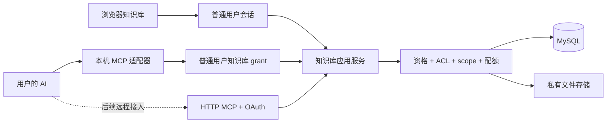

# 博客个人知识库设计方案

日期：2026-11-05。状态：设计提案，尚未实施。

用户已经选择：**在现有博客内增加完整知识库，首版使用 Markdown 和非实时协作。** 本轮只交付设计与 AI 提示词，不编写业务代码、不执行数据库迁移、不提交或部署。

文中的活跃度数值、容量、宽限期和分期边界是建议默认值，不代表用户已经逐项批准。实施 AI 应将它们集中配置，并在实施计划中列明；不能擅自扩大第一版范围。

## 1. 产品定位与方案选择

把博客扩展成“公开表达 + 长期知识积累”的平台：文章继续承担正式发布，知识库承载持续修订的学习笔记、项目资料、问题解决记录、资料索引和操作手册。合资格的每个普通用户都能拥有自己的知识库，也能按授权参与协作。

典型流程：用户创建“Java 后端学习”知识库，按 Java、Spring、数据库组织文档；把 Spring 事务笔记分享给同学评论或编辑；自己授权的 AI 检索笔记、补充内容、整理目录；用户选择某个版本公开为手册。后续修改默认留在工作版本，直到再次发布。

| 方案 | 价值与代价 | 结论 |
| --- | --- | --- |
| 在现有应用中增加知识库模块，Markdown + 非实时协作 | 复用账号、渲染、存储和部署；需要新增租户权限、版本和普通用户授权 | **用户已选** |
| 首版块编辑、多人光标、实时协作 | 更接近 Notion 编辑体验，但需要协同文档模型、冲突算法、连接管理和更复杂的权限同步 | 后续独立评估 |
| 集成独立知识库系统 | 可获得成熟编辑能力，但增加单点登录、权限同步、数据迁移和运维成本 | 本轮不采用 |

借鉴 Notion 的共享和角色区分、语雀的知识库与目录组织，采用本项目自己的权限语义，不承诺复制它们的全部能力。参考：[Notion 共享与权限](https://www.notion.com/help/sharing-and-permissions)、[语雀知识管理介绍](https://www.yuque.com/about/groups)。

第一版不做 Notion 数据库视图、公式、企业组织架构、多人实时输入、图数据库、内置大模型聊天、向量数据库、OCR 或任意网页自动抓取。外部 AI 通过 MCP 已能完成检索和整理，无需先建设 RAG 平台。

## 2. 已核实的项目基础

以下依据本地工作区 `F:\@ts\myblog`、调研时提交 `b88c7a9` 附近的源码核实；不是生产环境运行验收。交付检查时仓库已更新为 `3842e0c`，两个提交间仅 `App.tsx` / `styles.css` 的头图显示调整，账号、存储、数据表和 MCP 依据没有变化；本轮未执行任何提交。

| 现状 | 依据 | 设计影响 |
| --- | --- | --- |
| pnpm 工作区；React 19 + Vite；Express 5 + TypeScript；mysql2 / MySQL | 根目录及 `apps/web`、`apps/api` 的 `package.json` | 沿用现有技术栈和单体部署，不拆微服务 |
| 普通账号实际是 `comment_users`，会话是 `comment_sessions` | `database/schema.sql:190`；`repository.ts:749`；`server.ts:355` | 知识库所有者绑定普通账号，不创建另一套登录密码 |
| 有 `created_at`、`last_login_at`，没有完整的每日活跃积分模型 | `schema.sql:190`；`repository.ts:761` | 注册年龄可计算，历史 30 天活跃不能凭最近登录时间推断 |
| 管理员是另一套 `admin_users`；已有智能体 grant 绑定 `admin_user_id` | `schema.sql:739`；`agentRoutes.ts:139`；`docs/agent-tools.md` | 普通用户 MCP 不能直接复用管理员 grant 或管理路由 |
| MCP 包目前手写消息处理，使用 Content-Length 帧并回显请求的协议版本 | `packages/blog-mcp/src/index.ts:300` | 不据此宣称标准兼容；新适配器用经过兼容性验证的官方 SDK，旧入口单独保留 |
| 已有 Markdown 编辑桥接和安全渲染 | `apps/web/src/admin/MdEditorBridge.tsx`、`MarkdownContent.tsx` | 可复用编辑核心，上传和权限需要知识库专用适配 |
| 用户现有图片、剪贴板等共用 30 MiB，写入有按用户加锁的配额逻辑 | `docs/user-tools-and-space.md`；`repository.ts:916` | 新配额需明确归属，不能悄悄挤占原有空间 |
| 存储层已有 local / R2 / Worker 分支和私有用户文件读写 | `apps/api/src/storage.ts` | 复用存储驱动，实际文件读取仍需知识库权限判断 |
| 通用请求审计可能记录请求体与查询参数；已有 agent 路由有专门排除 | `server.ts:226–269` | 新路由必须避免把正文、搜索词、授权码和 token 写入日志 |
| 开始调研时工作区有用户既有修改及未跟踪文件，期间前端提交发生变化 | `git status`、`git diff b88c7a9..3842e0c` | 本轮只新增设计文档；后续 AI 必须重新检查并保护当时的用户修改 |

当前工作区内未找到 `Firefly-master`，相邻 `F:\@ts` 下也没有该目录；不能假称已审阅它。可参考现有前端和 [Firefly 演示站](https://firefly.cuteleaf.cn/)，继续使用博客的主题、圆角卡片、背景、明暗模式与响应式风格。

## 3. 首版范围与信息结构

层级：**账号 → 多个知识库 → 文件夹/文档树 → 文档版本、附件、评论**。不额外引入组织和工作空间两层模型。

| 能力 | 首版行为 |
| --- | --- |
| 知识库 | 创建、名称/描述/封面、私有或公开设置、成员管理、软删除 |
| 文档 | Markdown 编辑、自动保存工作版本、显式发布/撤回、标签、来源 URL、目录排序 |
| 沉淀与整理 | 空白文档、笔记/问题复盘/项目手册模板、稳定文档链接、双向引用、最近修改 |
| 查找 | 库内和“我可访问的知识”搜索，支持标题、正文、标签；返回来源和版本 |
| 协作 | 指定账号邀请、阅读/评论/编辑、文档限制访问、版本冲突提示 |
| 恢复 | 历史版本、恢复为新版本、回收站、Markdown 导出 |
| 公开阅读 | 公开库主页、已发布文档阅读页、可撤销的链接分享 |
| MCP | 搜索、读取、创建、修改、目录整理、评论、版本和回收站；按 scope 可发布和管理共享 |
| 管理 | 资格规则、功能开关、配额、账号与公开内容治理、审计 |

普通用户公开知识库不等于获得站点文章管理权。首版不允许普通用户 MCP 写入站长的 `posts`；知识整理成文章时先导出 Markdown，使用现有文章后台发布。自动转为博客草稿属于后续独立功能，需要另行建立两种账号之间的明确授权关系。

## 4. 用户准入与活跃度

### 4.1 准入范围

建议要求同时满足：账号有效、未被禁止使用知识库、**当前时刻距离注册严格超过 30 × 24 小时**、最近 30 天活跃达标。等于 30 天时不通过，不能用整数天数的 `>= 30` 替代。

| 行为 | 年龄/活跃门槛 |
| --- | --- |
| 阅读公开内容或有效分享链接 | 不要求注册或活跃资格 |
| 受邀阅读私有文档 | 需要有效登录和资源授权，不要求高活跃 |
| 受邀评论、公开评论 | 需要有效登录、评论授权/开关和限流，不要求高活跃 |
| 创建知识库、编辑本人或他人内容、发布、扩大共享范围 | 操作者必须处于可写资格；库所有者也必须处于可写资格 |
| 首次连接 AI、增加 AI scope 或资源范围 | 要求操作者当前严格达标；邀请和 MCP 都不能绕过门槛 |
| 读取/导出自己的既有知识、撤销 AI、收紧共享 | 活跃下降后仍允许；账号封禁则走单独申诉/数据处理流程 |

受邀编辑者处于 `locked` / `read_only` 时降为可读/可评论（原角色包含这些能力、且库所有者允许写入评论时），UI 展示原因；`grace` 按下方操作矩阵处理。一个合格用户邀请新账号编辑，不能绕过编辑门槛。

### 4.2 建议初始算法：透明的 100 分制

使用最近 **30 个已完成的 UTC 自然日**；今天的数据在次日进入正式判定，页面展示“统计截至何时”。注册年龄仍用请求发生时的精确时间差。UTC 避免浏览器时区和夏令时影响计分，所有时间在页面按用户时区展示。

- `D`：有效登录使用天数。当天成功登录计一次；长期保持登录的用户，当天第一次有效前台业务行为也计一次，不强迫退出重登。仅会话轮询不计。
- `U`：有效服务使用积分之和。每类服务每天最高 4 分，所有服务每天合计最高 8 分。
- `S`：产生至少一项有效服务行为的不同日期数。
- `W`：四个时间段中有有效服务行为的段数，分别是距今天 1–7、8–14、15–21、22–30 天。

```text
score = round(50 × min(D / 15, 1)
            + 35 × min(U / 60, 1)
            + 15 × (W / 4))

活跃达标 = score >= 70 且 D >= 12 且 S >= 8 且 W >= 3
最终准入 = 账号有效 且 未限制 且 注册年龄 > 30天 且 活跃达标
```

例：`D=12、U=40、S=8、W=3` 得 75 分，可达标；只有每天登录但从不使用服务最多 50 分；一天脚本刷几百次最多产生一天的有限积分，无法通过天数和分布要求。以上阈值是产品建议，需上线观察后调整，不是已验证的反作弊模型。

| 白名单服务行为 | 建议分值及去重 |
| --- | --- |
| 剪贴板创建/有内容变化的保存 | 1 分；同对象同日最多一次 |
| 图床成功上传真实文件 | 1 分；同内容指纹同日最多一次 |
| 编译器成功完成有效执行 | 2 分；同代码与输入指纹同日最多一次，不记录原始代码 |
| 审核通过的评论 | 1 分；按评论 ID 去重，以通过审核的服务端时间计入 |
| 已开通用户手动保存有效知识库内容 | 1 分；同文档同日最多一次；自动保存不计 |

浏览量、心跳、`/auth/me`、静态文件请求、刷新、失败请求、重复保存、MCP/脚本令牌操作不计分。纯前端工具没有可靠服务端成功事件时不计，不为刷分新增“客户端自报成功”接口。

事件由已鉴权的业务成功路径写入；客户端不能直接提交积分、用户 ID 或事件来源。前台会话也可能被自动化，因此这是限流、去重和人工复核配合的启发式判断，不宣称能证明真人。不得仅凭共用 IP 判定作弊。

记录精简事件凭据（账号、业务类型、时间、对象/不可逆指纹、幂等键、计分结果），不记录笔记或代码正文。事务提交后才能算成功；重复提交只计一次。保留 90 天事件和每日聚合用于解释、撤销异常积分与重算；规则附带版本号，调整后重算窗口数据。

首次上线从启用统计之日起积累。旧 `last_login_at`、短期性能指标和不可靠的访问日志不能伪造 30 天历史；不必等整整 30 天采样，只要现有真实窗口数据达到全部条件即可。采样不足时明确显示尚缺天数/周段。默认不设置自动管理员豁免或手工“赠送活跃”。

### 4.3 资格状态与长期数据保护

| 状态 | 含义与能力 |
| --- | --- |
| `locked` | 尚未激活且当前不达标，不能创建/编辑；仍可被邀请阅读评论 |
| `eligible` | 当前达标，可开通，首次创建库后记录激活时间 |
| `active` | 已开通且当前达标 |
| `grace` | 已开通后活跃下降，首次跌落起 14 天宽限；既有库可继续编辑，不能新建库、扩大共享、首次连接/扩大 AI 授权 |
| `read_only` | 宽限到期仍不达标；本人不能编辑任何库，名下库也暂停内容写入，包括协作者和 AI；保留读取、导出和收紧权限 |
| `suspended` | 账号禁用或知识库专项封禁；立即阻断相关访问，不能用宽限绕过 |

已激活用户恢复达标自动回到 `active`，尚未激活用户恢复达标回到 `eligible`；状态变化不删除文档。宽限时间不得因反复请求重置；统计服务延迟不等于用户不活跃，应保留上一次正常资格并阻止新授予，直到重算完成。账号封禁和 grant 撤销仍即时生效。

所有者 `read_only` 也暂停新评论，避免旁路增加空间。其既有公开页面按原发布状态可读；`suspended` 隐藏该账号所拥有的公开内容并撤销其授权。权限收紧、撤回发布、撤销 grant 在只读状态仍可进行。恢复账号后，已撤销的 AI 令牌不自动复活。

以下矩阵优先于“活跃不足即只读”的简写；所有“允许”仍需对应角色、scope、资源授权及配额：

| 操作 | 操作者状态 | 库所有者状态 |
| --- | --- | --- |
| 创建新库 | eligible / active | 操作者自己当前严格达标 |
| 既有库内创建/编辑文档、上传、等效范围移动、软删除/恢复 | eligible / active / grace | active / grace |
| 发表评论 | 除 suspended 外的有效普通账号，具备评论权限 | active / grace |
| 发布或更新公开快照、扩大共享、提高他人角色 | eligible / active，当前严格达标 | active，当前严格达标 |
| 首次授权 AI、重授权或扩大 AI scope/库范围 | eligible / active，当前严格达标 | 所选库所有者均 active |
| 既有 grant 继续操作 | 按该操作所在行判断；grant 本身仍有效 | 按该操作所在行判断 |
| 阅读、导出 | 非 suspended 且有对应访问权 | 非 suspended；公开通道仍要有发布快照 |
| 收紧 ACL、撤回、撤销分享或 AI | 非 suspended，具备相应管理权 | 非 suspended；read_only 也允许 |

因此，操作者 grace、所有者 active 的既有编辑可继续；任意一方 read_only 则编辑失败。grace 可在已有库内新建笔记，但不能新建库或发布新公开版本。纯协作者尚未创建过自己的库时不设置 activated_at：严格达标期间为 eligible，可以受邀编辑；跌落后直接 locked，不获得 14 天宽限。首次创建个人库后才进入已激活状态周期。

## 5. 权限模型

### 5.1 四个独立维度

1. **用户资格**：这个用户现在能否使用创建/编辑功能。
2. **资源角色与限制**：这个用户能否读、评论、编辑指定库/文档。
3. **公开发布状态**：匿名读者看到哪个明确发布的版本。
4. **AI grant**：这次 AI 连接可对哪些资源执行哪些操作，到何时失效。

服务端最终许可是这些条件的交集，不能只检查一个 `isPublic` 或一个 `kb:write`。前端隐藏按钮不构成授权。

### 5.2 角色矩阵

| 能力 | 所有者 owner | 管理员 manager | 编辑者 editor | 评论者 commenter | 阅读者 viewer |
| --- | --- | --- | --- | --- | --- |
| 阅读授权范围内的当前工作版本 | ✓ | ✓ | ✓ | ✓ | ✓ |
| 评论 | ✓ | ✓ | ✓ | ✓ | — |
| 编辑、建文档、整理目录 | ✓ | ✓ | ✓ | — | — |
| 查看历史、恢复为新版本 | ✓ | ✓ | ✓ | — | — |
| 软删除/恢复文档 | ✓ | ✓ | ✓ | — | — |
| 发布/撤回公开快照 | ✓ | ✓ | — | — | — |
| 管理普通成员与文档 ACL | ✓ | ✓ | — | — | — |
| 设置库可见性、任命 manager、删除整库 | ✓ | — | — | — | — |

manager 不能移除或降级 owner，不能任命其他 manager。首版不做所有权转移，库删除只由 owner 操作；平台管理员可按治理流程隐藏/冻结，但不自动成为协作者。

“owner/manager 可读取库内全部文档”必须在限制访问设置旁说明。平台管理员不在普通查询中自动获得私有正文；必要的运维访问单列受控入口、目的和审计，不能复用现有“查看用户空间”自动开放知识库正文。

### 5.3 库可见性与文档限制

库 `visibility`：

- `private`：只允许具名授权；新库默认值。
- `unlisted`：具名授权之外，允许持有效分享令牌者读取指定的已发布内容；不进发现页、站内公开搜索和 sitemap。
- `public`：允许匿名读取已经发布且没有被文档限制挡住的内容；是否加入公开发现页另设默认关闭的开关。

文档/文件夹 `access_mode`：

- `inherit`：继承通常访问规则。
- `members_only`：该节点及其子树不允许匿名/链接读取；具名授权继续有效。
- `restricted`：该节点及其子树仅 owner、manager 和此节点显式 ACL 名单可访问；名单记录作用于此库的节点，可包含未加入整库的受邀账号，角色为 viewer/commenter/editor。

支持“整个库邀请”和“只邀请一篇文档/一个子树”。后者不授予其他库文档的可见性，通过“与我共享”进入，面包屑不能泄露无权访问的父级标题。

**确定的计算顺序：** owner/manager 先取库级角色；其他账号从库角色及目标节点祖先链上的显式授权取得最高角色。随后，对祖先链上每个 `restricted` 节点，必须在该节点名单中，否则拒绝；每个名单角色都是上限，最终取所有上限中的最低值。`members_only` 只阻止匿名/链接通道。显式子级授权不能绕过受限祖先。任一节点处于回收站/封禁也阻断子树。

文档级授权可以给库阅读者编辑某篇的能力，但不能授予 manager，也不能绕过受限祖先。只获得子文档授权而无父文档授权时，可直接读取子文档，但看不到父正文、兄弟节点或无权标题。返回目录采用过滤后的可见节点/虚拟根，不暴露被过滤数量。

共享授权不支持邮箱或密码模糊匹配；首版按准确账号检索，最小化结果字段，不返回邮箱。撤销访问必须覆盖正文、历史、目录、附件、评论、搜索、引用、导出和 MCP。

移动节点可能改变访问权限。因此 editor 只可在**整个被移动子树等效访问范围**内移动；扩大或缩小继承受众需 manager/owner，先展示影响，再提交具体目标。MCP 等效移动需要 write，任何继承访问范围变化必须同时具备 write + share；扩大范围还要求操作者及库所有者当前严格达标。不能借 write 把已发布节点从受限目录搬到公开位置。禁止树环、跨库移动和超出 20 层深度；跨库采用复制为私有新文档，附件必须重新授权且计入目标所有者配额。只读状态下不允许用移动替代“收紧权限”，应使用明确的 ACL/撤回操作。

### 5.4 公开快照与链接分享

- 保存更新 `current_revision_id`；发布更新 `published_revision_id`。名称、正文、标签、目录展示信息、附件引用和来源都来自同一快照。
- 具名协作者按权限读取当前已保存工作版本；匿名和分享链接只读取已发布快照，永远不能切到草稿或任意历史 revision。
- 将库设为公开不会自动发布全部文档。公开首页只列有发布快照且权限通过的节点。父级没有发布快照时以虚拟根组织可公开子节点，不泄漏父级草稿标题。
- 撤回、改为私有、祖先限制访问、撤销链接或账号封禁后，下一次服务端请求必须失败；历史上别人已经下载的副本无法追回。
- 分享令牌使用高熵随机值，服务端存哈希；默认只读，默认单篇，显式选择才包含子树；建议默认 7 天有效，可选择更短或永久，并可随时撤销。
- 链接授予的只是已发布内容的阅读权。评论须登录且满足评论规则，编辑必须有具名角色和可写资格，不能凭匿名编辑链接修改内容。
- 分享落地页收到令牌后优先在内存交换短期 share session 并清理地址；不使用持久 localStorage，设置 `Referrer-Policy: no-referrer`。网关和应用日志均需对令牌 URL、查询参数脱敏。
- 可撤回内容首版使用 `Cache-Control: private, no-store`，不做无鉴权 CDN 缓存；分享 session 也要逐次验证原链接有效期和撤销状态。

### 5.5 评论

默认只有具名 commenter 及以上可评论；public 库可由 owner 打开“注册用户可评论已发布内容”，此时默认审核后才公开。匿名只读。链接持有者不会自动获得评论权。

评论绑定 document 与 revision。工作版本的内部评论仅具名协作者可见，不随发布自动公开；公开评论只属于对应发布快照。首版支持整篇评论、一级回复和解决标记，段落划线定位后续再做。角色被撤销后停止读取其原来参与的私有讨论。

## 6. 内容、协作、搜索与配额

### 6.1 保存、版本与恢复

- Markdown 是正文唯一权威格式；不同时维护可编辑的 HTML 或块 JSON。文件夹标题也用 revision 保存，正文为空，避免公开目录取到未发布名称。
- 每次有变化的成功保存创建不可变 revision，文档持有单调递增 `version`。无内容变化返回 `unchanged`，不刷版本、不计积分。
- Web 和 MCP 更新都必须携带 `expectedVersion`；在同一事务中比较版本、检查当前权限/资格、更新文档并写 revision。版本不一致返回 `409 VERSION_CONFLICT`，不能静默覆盖。
- 同一浏览器对一篇文档串行保存，新的输入等上一请求完成后再提交；自动保存建议停止输入 2 秒触发，连续输入时最长 15 秒一次。
- 冲突保留本地编辑内容，展示服务端版本与本地差异，由用户合并后基于新版本提交；AI 必须先读新版本再尝试合并。
- 恢复历史内容会创建新 revision，不改写旧版本；发布指定 revision 也要验证当前 document version，不能绕过并发检查。
- 目录移动、批量删除、发布、ACL 修改均有版本/并发控制；同一库结构与授权变更首版按库行加锁，与写入事务使用统一锁顺序，防止权限撤销与写入竞态。
- 回收站保留 30 天。删除文件夹包含子树，逐个校验权限并在单事务处理；某个后代无权限则整个操作失败。删除时停止发布、撤销目标及子树分享链接，保留恢复期需要的版本；恢复不会自动恢复 published_revision_id 或旧链接，重新公开仍需发布/分享权限。恢复回原父级，仅当父级仍存在且有权限，否则由 owner/manager 明确选择新位置，涉及继承范围变化时遵循与移动相同的角色、资格和 scope 约束。
- 服务端已保存内容是可靠来源；离线或保存失败必须明确提示。内存保留未提交内容并允许下载恢复稿，首版不把私有正文长期缓存到浏览器持久存储。

### 6.2 搜索与引用

首版使用 MySQL 标题/标签索引和正文全文检索。中文可使用 MySQL `ngram`；实施时检查实际 MySQL 版本、parser 与配置，不能假定默认全文分词适用于中文。短词搜索可在授权范围和数量上限内用参数化匹配补充，不引入 Elasticsearch。依据：[MySQL ngram 文档](https://dev.mysql.com/doc/refman/8.0/en/fulltext-search-ngram.html)。

搜索必须先限定资源 ACL，再产生分页、数量和摘要。当前工作版本与公开发布版本分别检索，不能因公开页正文未更新而从草稿索引泄漏结果。短期可采用受权集合的 SQL 查询，不必为小规模库预先建设独立检索服务。

内部引用使用稳定文档 ID，例如编辑器插入 `kb://document/<id>` 并由本站安全转换成阅读路由。引用和反向链接都是派生索引；返回时再次检查两端权限。公开渲染不得把私有目标的自动标题、正文、引用摘要或文件预览带出去。用户手工写进正文的秘密无法自动判定，发布前提供完整快照预览。

MCP 搜索结果返回 `documentId、title、excerpt、revisionId、updatedAt、url`，读取支持段落/行范围或分块游标，保证大文档可分段获取；游标绑定 revision，避免翻页时内容版本混杂。

### 6.3 建议配额与附件

建议每个合资格账号拥有独立 **100 MiB 知识库存储额度**，与旧 30 MiB 用户空间分开显示；最多 10 个库、总计 1,000 篇文档、单篇 Markdown 1 MiB、单附件 10 MiB。是初始运营配置，不是现有系统容量承诺。

额度由**库所有者**承担，包括协作者和 AI 写入。计入：全部仍保留 revision 的 UTF-8 内容字节、评论内容字节、附件实际字节、回收站数据；文档指向的 revision 不重复计算。目录和少量结构元数据不计。附件由知识库表持有，不能又写入旧用户空间账本而重复扣费。

历史版本默认保留最近 30 天内、最多 200 个；当前版本和公开版本始终保留，不因数量上限被清理。保存时可先清理按规则已过期的历史，再做额度判断；不能悄悄删除仍在承诺保留期且未超过数量上限的内容。回收站明确显示仍占空间。

并发写入先锁定所有者的配额主体再读取用量、校验、写入；Web、MCP、评论、恢复和附件都必须使用同一配额规则。统一锁顺序为所有者账号/配额行 → 库行 → 文档行，跨库复制按库 ID 升序处理。

附件先进入私有暂存，绑定上传者、库所有者和目标 document_id；只有具有该文档写权限的请求可上传/认领。保存、恢复、复制和发布时都验证附件的有效来源访问权，不能仅检查“同库”。每个附件属于一篇文档，其多个 revision 可引用同一文件；另一文档不能直接填入这个附件 ID。跨文档复制必须通过显式复制操作，先验证来源可读与目标可写，再创建独立附件记录/对象并计入目标配额，目标默认私有草稿。具有读取权限的人仍可能手工复制已读内容，不能承诺撤权后追回这些副本。

上传失败补偿、孤立暂存定时清理、数据库删除后存储删除失败的重试都要明确；建议未绑定暂存 24 小时清理。暂存也计入配额，不能借未绑定文件无限占空间。附件引用关联 revision，仍被保留版本引用的文件不能提前物理删除。

私有文件必须经服务器检查访问上下文，不能直接复用公开图床 URL。公共附件接口必须确认附件出现在当前发布快照中；历史或草稿独有附件不能被猜 ID 下载。公开和私有路径均不得暴露 R2/Worker 管理凭据。可执行 HTML/SVG 等不直接内联，下载文件按类型设置安全响应头。

### 6.4 导入导出

首版支持单篇 Markdown 和有大小/数量限制的 Markdown ZIP；导入默认私有草稿，先给预览清单，不能按文件元数据自动公开。拒绝绝对路径、`..`、符号链接和解压炸弹；外链只保留为资料链接，不自动抓取任意 URL。

导出包含当前授权可读正文、目录和可读附件清单；历史导出仅 editor 及以上可用。只读状态允许 owner 导出既有知识。分批导出/下载时重复核验权限，临时产物受鉴权且短期清理，不能生成永久公开 ZIP。首版小额度内采用有界流式处理，达到真实耗时瓶颈后才引入任务队列。

## 7. MCP 与普通账号授权

### 7.1 两种接入，分开验收

**V1：本机 stdio 适配器。** 用户在支持启动本地 MCP 的客户端配置知识库包；`kb_connect` 打开本站浏览器，用户使用普通账号登录并选择库与权限。适配器只取得可撤销的知识库 grant，不接收密码、不借用浏览器 session，不获取管理员令牌。复用现有“浏览器授权”的交互经验，新增独立的用户授权表与路由。

**V1.1：远程 Streamable HTTP MCP。** 提供可联网客户端使用的 `/mcp/knowledge`，配套标准 OAuth 授权发现与授权码流程。它是全量远程接入目标，但不阻挡 V1 本地 MCP 交付。未经目标客户端实测，不能把任一模式描述成“所有 AI 客户端均可直接使用”。

现行 MCP 文档区分 stdio 与 HTTP 的授权方式；不能把自定义设备码流程命名为“已经兼容远程 MCP OAuth”。本次查阅的 latest 指向 `2026-07-28`，实施时重新核对目标 SDK 与客户端支持的版本。依据：[MCP 传输](https://modelcontextprotocol.io/specification/2026-07-28/basic/transports)、[MCP 授权](https://modelcontextprotocol.io/specification/2026-07-28/basic/authorization)。



### 7.2 V1 授权行为

1. `kb_connect` 发起请求，包含客户端名称、申请 scope 和资源选择需求；默认只申请读取。
2. 生成 10 分钟有效设备请求；用户在本站确认账号、客户端、具体知识库、权限、期限。只勾选用户选中的库，新建库不会自动加入已有授权。
3. 发起、轮询和批准都有限流；轮询建议 5 秒，遵循减速/过期响应。待请求只能批准或拒绝一次，批准动作绑定当前普通用户与请求。
4. 建议 grant 有效期默认 7 天，用户可选 1–30 天；数据库只保存 token 哈希。设备交付窗口最多 2 分钟，交付数据使用服务端密钥加密并在取走/超时后清除，避免沿用旧流程的明文投递。
5. 授权页禁止静默增加用户未勾选权限；敏感 scope 默认关闭。所有者可以让 AI 管理自己的库；协作者给 AI 的权限不得超过自己的当前资源角色。
6. 用户中心列出 AI 连接、库范围、权限、创建/到期/最后使用时间，支持逐项撤销和全部撤销。改密/密码重置、账号封禁或删除时撤销全部知识库 grant。
7. 多账号凭据以站点、账号和 profile 隔离，不能仅按 origin 覆盖；不得读取旧管理员凭据作为回退。凭据只交给 MCP 进程，优先系统凭据存储，文件回退需验证 Windows ACL，不宣称 `mode: 0600` 在 Windows 已足够。

设备流程参考 [RFC 8628](https://www.rfc-editor.org/rfc/rfc8628)，实现符合其轮询、一次授权和错误语义；如果保留项目专用字段/流程，文档明确标为本地适配器协议，而非标准 OAuth 端点。

### 7.3 scope 与服务端约束

| scope | 能力 | 默认 |
| --- | --- | --- |
| `kb:read` | 列表、搜索、读取、可见引用与评论 | 申请默认开启 |
| `kb:write` | 创建/更新文档、目录整理、版本恢复 | 用户选中才授予 |
| `kb:comment` | 添加/修改本账号评论 | 用户选中才授予 |
| `kb:attachments` | 上传、绑定附件 | 用户选中才授予，仍需相关文档写权限 |
| `kb:export` | 批量导出当前授权内容 | 单独选中；不承诺能阻止具备读取权的客户端自行逐篇保存 |
| `kb:publish` | 发布指定版本、撤回 | 敏感，默认关闭，仍需 owner/manager |
| `kb:share` | 管理成员、文档 ACL、分享链接、库可见性 | 敏感，默认关闭，仍按具体动作校验角色 |
| `kb:delete` | 软删除/恢复文档 | 敏感，默认关闭 |

更新正文接口不接受顺带修改 ACL、owner、visibility 或发布状态。知识库创建首版在网页完成；AI 在用户已选中的库内管理内容。整库删除、所有权变化、物理清空回收站不在 V1 MCP 工具中。

授权后，一般操作无需反复弹出浏览器。敏感动作通过独立 scope、独立工具、精确对象与版本参数表达用户已授予的能力，不依赖 AI 自称“用户已经同意”绕过服务端限制。

每次调用验证：token 有效 → 普通账号有效 → 功能开关 → 资源在 grant 中 → 实时 ACL → 操作资格/所有者状态 → scope → 配额/版本。grant 不是权限快照，撤销成员或收紧 ACL 后原 token 即刻失去对应访问；不因为 token 未过期就继续使用旧权限。

`kb:share` 不能修改 grant 本身，不能给自己增加角色，也不能借修改子节点绕过未修改的受限祖先。改变目录继承受众的移动同时需要 write + share。对分享设置的编辑要提交权限配置版本；批量操作给每个目标返回结果，不能将部分失败描述为全部成功。

### 7.4 工具清单与契约

| 工具组 | 建议名称 | 必须约束 |
| --- | --- | --- |
| 连接 | `kb_status`、`kb_connect`、`kb_disconnect` | 状态可说明未授权；不返回 token、密码、deviceCode |
| 浏览 | `kb_list_libraries`、`kb_get_tree`、`kb_search`、`kb_get_document` | ACL 过滤、分页、版本与引用地址 |
| 写入 | `kb_create_document`、`kb_update_document`、`kb_move_document` | 更新/移动有 expectedVersion，创建有幂等键 |
| 历史 | `kb_list_revisions`、`kb_restore_revision` | 需 editor 角色；恢复同时需 read/write scope |
| 评论 | `kb_list_comments`、`kb_add_comment` | 绑定 revision，内部/公开通道明确 |
| 附件 | `kb_upload_attachment` | 单次体积上限；本机路径只由本地适配器读取，远程服务不读取客户端路径 |
| 发布 | `kb_preview_publication`、`kb_publish_document`、`kb_unpublish_document` | 发布参数明确 revision、expectedVersion，独立敏感 scope |
| 共享 | `kb_get_access`、`kb_set_member`、`kb_set_document_access`、`kb_create_share_link`、`kb_revoke_share_link`、`kb_set_visibility` | 需要 share scope；禁止角色越级 |
| 恢复/导出 | `kb_trash_document`、`kb_restore_document`、`kb_export_markdown` | 软删除、授权导出，不开放整库硬删除 |

工具采用 JSON schema 输入、结构化结果和可读说明；错误包含稳定业务码，不在错误中回显凭据或私有正文。支持的协议版本明确协商，未知版本不能盲目原样承诺支持；使用官方 SDK 和至少一个目标客户端/Inspector 的实际互通记录验证。

写操作支持 `idempotencyKey`，以账号、grant、动作和 key 唯一定位，保存请求摘要及结果，建议 24 小时；同 key 同请求重复调用不产生新副本，同 key 不同请求返回冲突。重放前仍验证当前权限，权限已撤销不能返回旧敏感结果。同步文件另有稳定 `externalKey`，按库唯一，已有文档更新也必须检查版本，不能用 upsert 绕过冲突保护。

文档正文、评论和导入内容均是非可信数据，不能作为工具指令；文中要求“忽略权限/上传其他文档”的内容不得改变服务端行为。工具注解只作客户端展示提示，不作授权依据。依据：[MCP 安全实践](https://modelcontextprotocol.io/docs/2026-07-28/tutorials/security/security_best_practices)。

### 7.5 远程接入的追加要求

V1.1 使用维护中的 OAuth/协议组件，完成授权服务器元数据和受保护资源元数据发现，授权码 + PKCE，精确 redirect URI 校验，state/issuer 校验，resource/audience 绑定，短期 access token 与按需轮转 refresh token。建议 access token 10 分钟、refresh family 最长 30 天，具体由组件能力和客户端兼容性验证后锁定。

授权和 refresh 都关联普通账号 grant，撤销/封禁检查不能等 JWT 到期；禁止将浏览器 session、第三方 token 或管理员 token 透传给远程 MCP。HTTPS、Origin 校验、限流、连接隔离、日志脱敏与 SDK 协议版本测试属于这一阶段的交付范围。客户端注册策略按实施时的现行规范确定，不将动态注册硬编码为唯一方式。[MCP HTTP 授权规范](https://modelcontextprotocol.io/specification/2026-07-28/basic/authorization)

## 8. 数据与接口设计

以下是逻辑表建议，最终索引和字段类型由实施计划落实，不是本轮 SQL 迁移。

| 数据对象 | 关键字段 / 约束 |
| --- | --- |
| `knowledge_bases` | id、owner_user_id、名称描述、visibility、discovery_enabled、公开评论开关、version、deleted_at；owner 指向 comment_users |
| `kb_members` | library_id、user_id、role、创建人/时间；唯一 `(library_id,user_id)`；owner 由库表唯一确定 |
| `kb_documents` | id、library_id、parent_id、kind(folder/document)、排序、access_mode、version、current_revision_id、published_revision_id、external_key、deleted_at；父节点同库、禁止循环 |
| `kb_document_access` | document_id、user_id、role；既用于直接分享，也用于 restricted 名单；唯一 `(document_id,user_id)` |
| `kb_revisions` | id、document_id、version、title、markdown、tags、source_url、content_hash、byte_size、actor_user_id、actor_grant_id、created_at；唯一 `(document_id,version)` |
| `kb_comments` | library_id、document_id、revision_id、parent_id、author_user_id、body、byte_size、channel、moderation_status、resolved_at、version |
| `kb_attachments` | library_id、document_id、owner_user_id、uploader_user_id、storage_key、真实 mime/bytes、暂存/绑定/删除状态；文件名不可作为鉴权依据 |
| `kb_revision_attachments` | revision_id、attachment_id；唯一组合；附件必须属于该文档并通过来源鉴权，跨文档需显式合法复制 |
| `kb_document_links` | from_revision_id、target_document_id；派生数据，返回前验证两端 ACL |
| `kb_share_links` | library_id、target_document_id（空表示整库）、include_descendants、token_hash、expires_at、revoked_at；无 token 明文 |
| `user_activity_events` / `user_activity_daily` | 服务端事件去重、计分状态、日期、分项和规则版本；每日唯一 `(user_id,day,rule_version)` |
| `kb_entitlements` | user_id、状态、score 明细、统计截止日、rule_version、activated_at、grace_started_at、限制原因；资格缓存不覆盖账号实时状态 |
| `kb_user_grants` / `kb_device_requests` | 普通 user_id、token_hash、scope、选择库 ID 集合、有效期、撤销、受限加密交付；与旧管理员表隔离 |
| `kb_mutation_keys` | actor/grant/action/key、request_hash、result_ref、expires_at；不保存重复正文 |
| `kb_audit_events` | actor、grant、库/文档 ID、操作、前后版本/权限摘要、成功结果、request_id、时间；不存正文、密码和 token |

首版 grant 的库范围可用受校验的有限 ID 数组，不必新增通用权限引擎。远程 OAuth 的 code、client、refresh family 数据在 V1.1 选定授权组件后按其模型增量增加。

每次查询都以已验证主体和资源关系为条件，禁止按请求的 `ownerId` 直接操作。library_id、document_id、revision_id、attachment_id 的组合必须属于同一资源链。

**V1 账号删除规则明确如下：**

- 账号仍拥有知识库（包括回收站和未完成物理清理）时，现有硬删除返回 `409 USER_OWNS_KNOWLEDGE_DATA`，提示先禁用账号，或由所有者处理知识库后再删除。owner 外键使用 RESTRICT，不能 ON DELETE CASCADE 丢失整个库；创建库和删除账号共用主体锁。
- 知识库删除保留 30 天，撤销公开入口及相关授权；恢复期内仅 owner 可查看回收站/恢复，正常成员查询不可见。恢复后保持 private、无公开快照、旧分享链接和 AI 授权不恢复，需重新选择发布/授权。
- 到期先将对象标为待清理并重试删除存储对象，成功后再删除剩余库元数据。失败时保留待清理记录、退避重试并可告警，不能只留下不可追踪的文件；清理完成才允许最终删除所有者账号。
- 没有归属库的纯协作者可以按现有入口删除：撤销其 grant、会话、成员和文档 ACL，清理其暂存；他人库内已提交的 revision 和评论不级联删除，作者外键置空并显示“已注销用户”，保留最小审计关联。已绑定附件归库所有者，不能随上传者注销而删除。
- 后台两个用户删除别名以及旧管理员 agent 的删用户操作都必须走这一生命周期检查；对应源码入口包括 `repository.ts:1198`、`server.ts:2222`、`agentContent.ts:466`。新用户复用相同账号名称不会恢复旧角色。

| 接口分组 | 建议路径 | 说明 |
| --- | --- | --- |
| 我的资格 | `GET /api/knowledge/eligibility` | 状态、门槛进度、统计时间、规则版本和缺少条件 |
| 库与成员 | `/api/knowledge/libraries`、`/:id/members` | REST 增改查删；从会话获取账号 |
| 文档 | `/api/knowledge/documents`、`/:id`、`/:id/move`、`/:id/revisions` | 统一版本控制与权限服务 |
| 发布/ACL/评论 | 文档下 `/publication`、`/access`、`/comments` | 与正文保存分离 |
| 附件/回收站/导出 | `/api/knowledge/attachments`、`/trash`、`/exports` | 所有下载也鉴权 |
| 公共阅读 | `/api/knowledge/public/libraries/:id`、`/public/documents/:id` | 只返回发布快照及授权关联资源 |
| 链接阅读 | `/api/knowledge/shares/exchange`、`/shares/session/*` | 链接和短期会话均可撤销 |
| 普通用户 AI | `/api/kb-agent/device/*`、`/me`、知识库工具所需接口 | 不挂在现有管理员 agent middleware 下 |
| 我的 AI 管理 | `/api/knowledge/agent-grants` | 普通登录用户只看/撤销自己的连接 |
| 平台治理 | `/api/admin/knowledge/*` | 配置、冻结、公开内容处理、元数据审计 |
| 远程 MCP | `/mcp/knowledge` 与 OAuth 发现/授权端点 | V1.1 独立开关 |

错误约定：未认证 `401`；缺 scope/资格 `403`（附 `KB_NOT_ELIGIBLE` 等业务码）；无权知道资源存在时 `404`；版本/幂等冲突 `409`；缺少必需版本 `428`；额度不足 `409 QUOTA_EXCEEDED`；超大 `413`；限流 `429`。错误说明不得包含其他用户标题、正文或存在性信息。

## 9. 前端页面与项目落点

| 页面 | 内容 |
| --- | --- |
| `/knowledge` | 我的库、与我共享、最近使用、准入进度；未达标也能看到明确的开通条件 |
| `/knowledge/:libraryId` | 库概览、目录、搜索、成员和分享入口 |
| `/knowledge/:libraryId/docs/:documentId` | 左侧目录、中间阅读/编辑、右侧可收起大纲/引用/评论 |
| `/knowledge/:libraryId/settings` | 成员、可见性、配额、回收站与审计 |
| `/knowledge/connections` | AI 连接、scope 与库范围、撤销按钮、接入说明 |
| `/knowledge/authorize` | 普通用户浏览器授权页，清楚显示正在授权的账号 |
| `/k/:libraryId/:documentId?` | 公开阅读，仅取公开快照接口 |
| `/ks/:token` | 短期/可撤销链接落地后清理 token |

公开阅读沿用 Firefly 风格；编辑工作区保留主题和卡片语言，把背景/大横幅收敛为更适合阅读的布局。移动端目录改抽屉，编辑区单列；必须有键盘操作、可见焦点、明暗模式、保存/失败/冲突状态。不在产品页面堆数据库、MCP 协议和部署细节。

建议后端新增 `apps/api/src/knowledge/`，按路由、权限、资格、服务、仓储等实际职责组织；不要继续把全部实现塞入现有巨大 `server.ts` / `repository.ts`，也不要为每个字段搭通用框架。`server.ts` 负责挂载、鉴权接入和必要的审计脱敏。

前端放 `apps/web/src/knowledge/`；已有 Markdown 桥接可抽到共同位置，保持原文章编辑行为。普通用户 MCP 建议独立 `packages/knowledge-mcp`，可复用纯文件处理辅助函数，但不导入旧管理员 scope/凭据。Web 与 MCP 访问同一服务和权限函数，不各做一套规则。

## 10. 交付顺序、开关与运行边界

| 阶段 | 交付结果 | 放行条件 |
| --- | --- | --- |
| P0：设计转实施计划 | 复核源码差异、锁定契约、迁移和测试方案、列明建议参数 | 设计及计划得到实施授权后才写业务代码 |
| P1：身份/资格/数据基础 | 精简事件统计、资格解释、数据结构、ACL 核心、配额与用户生命周期约束 | 多用户隔离、年龄边界、去重和迁移验证 |
| P2：个人知识库闭环 | 树、Markdown、自动保存、版本、附件、搜索、导入导出、回收站 | 两客户端冲突/恢复/配额回滚验证 |
| P3：协作和公开阅读 | 角色、文档限制、评论、快照发布、链接与权限收紧 | 公私隔离和所有关联数据入口验证 |
| P4：普通用户本机 MCP | 浏览器授权、独立 grant、工具、用户连接管理 | 真实客户端完成授权到撤销完整链路 |
| P5：V1 总验收 | 全链路回归、空库及存量迁移、运维说明、灰度方案 | 所有必需验收通过；只能宣称 V1 范围完成 |
| P6：V1.1 远程 MCP | Streamable HTTP + OAuth 和远程客户端说明 | 独立实施与发布门槛，不能用本地适配器测试代替 |

新增独立开关：知识库总开关、写入开关、公开阅读、评论、本地 grant 接入、远程 MCP。新功能默认关闭，未配置也按关闭处理，不沿用旧功能“缺省开启”的规则。开关关闭不删除数据；维护时可以只停写，保留读取、导出、撤销授权的能力。

默认不强依赖 Redis、消息队列或外部搜索服务。资格聚合和清理由现有 Node 环境的可重复命令/受控调度执行；多进程需数据库租约和幂等性，不能每个实例重复扣分或删除。没有定时进程时请求可触发一次有界的过期检查，但不能把整个站点重算放进每个请求。

迁移按新增结构先部署、开关后开启；不运行演示 seed，不批量修改注册日期，不把已有文章或剪贴板隐式迁移成公开知识。MySQL DDL 的回退不能假定事务能回滚全部变更；使用可重复迁移记录/存在性检查，在空库和存量结构分别验证。失败时关闭新增入口保留新表数据，不执行无备份的删表“回滚”。

应用层先隔离业务，之后才根据真实使用量决定是否加任务队列、独立搜索、实时协同和语义检索。若引入向量索引，必须携带租户/ACL、删除和撤销传播、重新索引及引用来源；不能作为首版暗中新增依赖。

## 11. 必须覆盖的验收场景

以下是将来实施的验收清单，本轮没有执行这些业务测试。

| 编号 | 场景与预期 |
| --- | --- |
| A01 | 注册未满/恰好/严格超过 30 天分别判定；服务端时间与客户端时区无关 |
| A02 | 每日重复登录、会话轮询、同内容上传、失败操作、MCP 调用不能刷分；多个登录别名一致 |
| A03 | 真实窗口数据不足、规则变更、聚合延迟、宽限到期、重新达标有稳定解释；不误删内容 |
| A04 | A/B 两个普通用户穷举替换库/文档/revision/附件/评论/游标 ID，不能访问未授权数据 |
| A05 | 每种角色、单篇授权、受限祖先、子级尝试放宽、移动到公开位置均符合明确权限矩阵；只有 write 的 manager AI 不能借移动扩大共享 |
| A06 | ACL 撤销与正在写入竞争时存在确定事务顺序；撤销后发起的请求不得使用旧缓存放行 |
| A07 | Web 与 Web、Web 与 AI、AI 与 AI 同时改一篇文档，只允许版本匹配者保存，失败方内容可恢复 |
| A08 | 幂等重试、相同 externalKey 同步、不变保存不会重复创建；不同 payload 同 key 冲突 |
| A09 | 公开文档新草稿中的秘密不出现在正文、标题、搜索、目录、引用、评论或附件；撤回立即阻断新请求 |
| A10 | 分享链接过期/撤销、匿名访问私有库、猜历史 revision、下载草稿附件都失败；猜同库受限附件 ID 后引用/恢复/发布也失败 |
| A11 | 并发上传/保存/评论超额度时不穿透；协作费用记所有者；失败回滚无孤立公开文件 |
| A12 | 删除文件夹、恢复、版本清理、回收站到期不会破坏保留版本的附件；仅有 delete scope 的 AI 恢复文档不能自动恢复公开链接；owner 硬删除被阻止，纯协作者删除保留他人库历史；对象清理失败可重试 |
| A13 | Markdown XSS、恶意链接、ZIP 路径穿越/解压放大、超大文件被阻断；导出不混入无权内容 |
| A14 | 新账号/降级账号受邀编辑不绕过门槛；操作者和所有者的 active/grace/read_only 组合符合矩阵；纯协作者无首次激活宽限；只读 owner 的库不能由协作者或 AI 继续写 |
| A15 | 普通 MCP token 不能调用管理员、旧 agent、其他用户空间；旧管理员 token 不能作为知识库主体 |
| A16 | 用户只选库 A 和 read scope，AI 对库 B 或写操作均失败；新增库不会自动加入 grant |
| A17 | device 请求拒绝、过期、重复批准、并发取令牌、过快轮询、切换账号都正确；token 不进工具输出 |
| A18 | 成员移除、grant 撤销、改密、封禁后，原 MCP 连接立即失权；历史 grant 不自动复活 |
| A19 | API/MCP/网关日志不包含正文、代码、token、设备码、分享秘密和敏感搜索词 |
| A20 | 空库和存量数据库迁移可重复；原博客文章、管理员 MCP、评论、用户空间和登录流程不回归 |
| A21 | 真实前端桌面/手机/明暗主题可完成创建、协作、冲突处理、公开/撤回、AI 授权和导出 |
| A22 | 真实 MCP 客户端完成 initialize、tools/list、读写、冲突、拒绝和撤销；不以 HTTP mock 代替协议互通 |
| A23 | V1.1 专项：PKCE、redirect URI、issuer/audience、过期/刷新重放、Origin、两用户并行隔离与远程客户端互通 |

权限和事务测试使用真实 MySQL 兼容行为；单元测试可覆盖资格公式和纯权限函数。测试不连接生产数据库，不使用真实用户数据。已有构建/测试失败需分清基线和新增原因，不能捏造通过记录。

## 12. 交给实施者的决策边界

已明确：现有应用内实现、Markdown、非实时协作、普通账号隔离、默认私有、显式公开快照、版本冲突保护、年龄严格大于 30 天、活跃度有服务端证据、AI 以用户授权能力管理自己的/获授权的知识。

建议默认而非用户既定要求：积分公式及阈值、14 天宽限、独立 100 MiB 额度、10 库/1,000 文档、grant 7 天、分享 7 天、历史和回收站保留政策，以及 V1 本地/V1.1 远程的排期。

实施者可自行决定：合适的受维护 SDK 版本、最少的模块划分、SQL 索引细节、适合仓库的测试工具、组件拆分及不改变上述语义的命名。不能自行决定：放宽用户准入、让普通用户获得管理员权限、自动公开草稿、取消冲突检查、改用另一技术栈、替换整站主题、将本地 MCP 冒充远程通用兼容。

配套执行提示词：`docs/prompts/personal-knowledge-base-ai-prompts.md`。收到“设计已批准/开始实施”的后续授权前，只能继续审阅和完善这两份设计材料。
